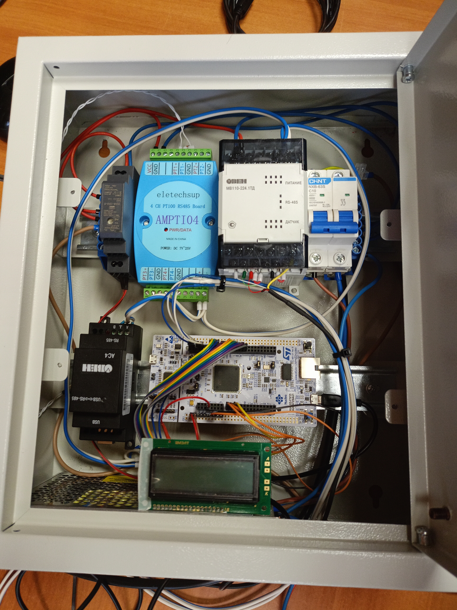
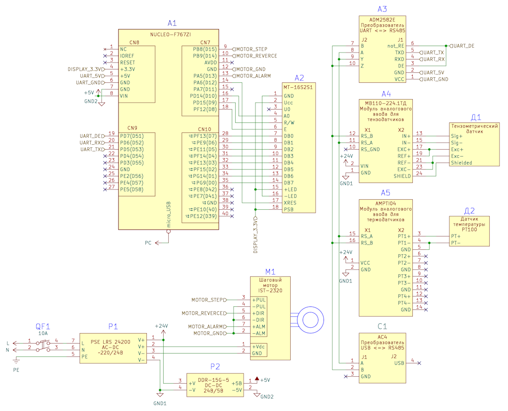

# Система управления индентером

В этом проекте представлена реализация системы управления для прибора "индентер" на базе микроконтроллера STM32F767ZIT собственной разработки.
Проект распростроняется под лицензией [GNU GPL v3](LICENSE.txt)

## Использование
Система предназначена для измерения твёрдости материала и получения соответсвующих параметров. Для этого установлен шаговый мотор, перемещающий измерительную (индентирующую) головку, закреплённую на линейном приводе через тензодатчик. Для учёта и компенсации влияния термических эффектов дополнительно установлен термометр. За съём, отцифровку и отправку на компьютер всех указанных параметров, а так же управление мотором и отвечает данная программа. За управление и сохранение полученных данных отвечает [настольное приложение](https://github.com/kolyaka32/Indenter-controller).

## Принципиальная схема
Дополнительно в программе [kicad](https://www.kicad.org/) была разработана общая электрическая схема шкафа.

## Настройка оборудования
Для настройки применяется отдельное внешнее подключение через USB-RS485 преобразователь, в процессе основной работы он участия не принимает.
Для настройки модуля ввода тензодатчиков (от ОВЕН) применялась фирменная утилита [m110-v11060](https://owen.ru/product/moduli_analogovogo_vvoda_signalov_tenzodatchikov/documentation_and_software). Для настройки модуля ввода термометра и проверки передачи пакетов данных применялось [Modbus RW](https://www.modbus-rw.ru/).

## Сборка и загрузка
Для работы над проектом применялись [cubeMX](https://www.st.com/en/development-tools/stm32cubemx.html) для подготовки и настройки входов, а для сборки и загрузки на микроконтроллер [cubeIDE](https://www.st.com/en/development-tools/stm32cubeide.html).
